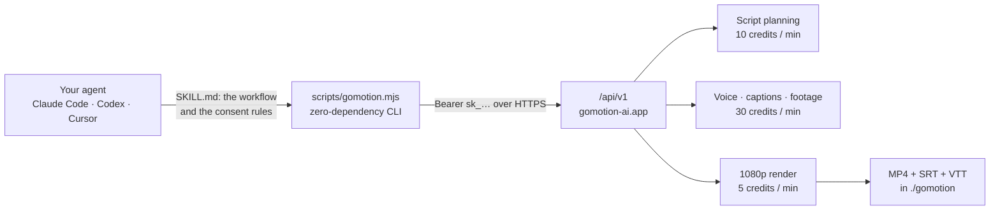

<p align="center">
  
</p>

<h1 align="center">Go Motion skill for Claude Code, Codex and Cursor</h1>

<p align="center">
  Tell your coding agent what the video is about. It writes the script, you approve it, and <a href="https://gomotion-ai.app?utm_source=github">Go Motion</a> records the voice, times the captions, finds the footage and renders a 1080p MP4 with SRT/VTT captions into your working folder.
</p>

<p align="center">
  <a href="#install">Install</a> ·
  <a href="#what-you-can-learn-from-it">Design notes</a> ·
  <a href="references/scriptwriting.md">Writing guide</a> ·
  <a href="references/api.md">API reference</a> ·
  <a href="examples/why-the-sky-is-blue/session.md">A real session</a> ·
  <a href="https://gomotion-ai.app/how-it-works/agent-skill?utm_source=github">Guide with screenshots</a>
</p>

<p align="center">
  <a href="https://cdn.gomotion-ai.app/site-assets/skill/why-the-sky-is-blue.mp4"></a>
  <br />
  <sub>“Why the sky is blue”: 60 seconds, 1080p, made from a one-paragraph brief for 50 credits. <a href="https://cdn.gomotion-ai.app/site-assets/skill/why-the-sky-is-blue.mp4">Full MP4</a> · <a href="examples/why-the-sky-is-blue/session.md">every command and answer of that session</a>.</sub>
</p>

## What you get

What the conversation looks like (the commands and answers behind it are in [the example](examples/why-the-sky-is-blue/session.md)):

```text
You:    Make a one-minute 16:9 explainer about why the sky is blue. End with why Mars has a butterscotch sky.
Agent:  Writing the script costs 10 credits (balance 299). Go ahead?
You:    yes
Agent:  Here are the 5 scenes (172 words). One thing: at 61 seconds this would be billed as
        two minutes (60 credits). Cutting six words gets it under a minute. Shall I?
You:    yes, then produce it
Agent:  Producing voice, captions and footage costs 30 credits. Go ahead?
You:    yes
Agent:  Export costs 10 credits: the timeline is 60.4 s, which counts as two started minutes. Go ahead?
You:    yes
Agent:  Done: gomotion/Why_the_sky_is_blue-r5.mp4 (+ .srt, .vtt), 1080p, 60 s.
        50 credits used, 249 left. Fine-tune pictures, captions or the voice in the studio: https://gomotion-ai.app/app/projects/…
        One picture needs a credit line in your description: Mars photograph, NASA/JPL-Caltech/MSSS via Wikimedia Commons.
```

- The MP4 (1080p, 30 fps), SRT and VTT captions in `./gomotion/`, and a studio link to fine-tune pictures, captions, voice or a thumbnail.
- Nothing spent without a yes: every paid step is quoted first, and the quote is a promise (see below).
- The same prices as the studio, no API surcharge. New accounts start with free credits that cover a first one-minute video.

## How it works



Free: creating a draft, reading and editing the script, estimating its length, previews in the studio. Paid, per started minute: the script, the production, the export. The agent sees the price and your balance before each one and asks. A job that fails refunds itself.

## What you can learn from it

The skill is small on purpose: a workflow file and a client of about 600 lines. The interesting part is the contract it relies on, which applies to any agent that spends money on your behalf.

### 1. Quote, cap, confirm

A paid request must carry `maxCredits`, the most the user agreed to. The server quotes, compares, signs and starts the job in one request, re-quoting inside the same transaction: if the price is above the cap it answers `QUOTE_EXCEEDS_BUDGET` with the real number and charges nothing; if the inputs or prices changed since the agent looked, `QUOTE_CHANGED`. There is no window between what the user saw and what is charged. `dryRun: true` returns the same numbers without starting anything, which is what the agent shows you before asking.

### 2. Money needs idempotency

Every paid request can carry an `idempotencyKey` (body or `Idempotency-Key` header). The same key replays the same job, so a retry after a timeout cannot charge twice; the same key with a different request is refused (`IDEMPOTENCY_CONFLICT`). The CLI accepts yours with `--idempotency-key`; the rule in SKILL.md is one key per logical action, a fresh one after a failure.

### 3. Review before you pay

The cheap step runs first: the script is written for 10 credits a minute and stops in `review`. Editing the scenes is free, and the expensive step runs on the text you approved. `estimate` tells you, before any quote, whether a six-word trim saves a whole minute; in the example it turned a 60-credit production into a 30-credit one.

### 4. Refunds are a contract, not a ticket

A job that fails returns its credits by itself (`refundedCredits` on the job), and a cancel before paid work started refunds too. So the agent's rule is simple: report the error, do not loop retries, retry once if the user wants.

### 5. A CLI an agent can trust

One JSON document on stdout, progress on stderr, exit codes 0, 1 and 2, `--wait` polls to a terminal state, a 429 is retried once after `Retry-After`, the key is read from the environment and never printed or written, no dependencies (Node 18+), and an `X-GoMotion-Client` header so usage can be attributed to the skill and the agent.

### 6. Pictures keep their papers

Every picture in a video records its source, author and license. The studio shows them, and the [example](examples/why-the-sky-is-blue/session.md#the-result-and-its-credits) lists them: three Pixabay clips, an AI illustration, and a NASA photograph from Wikimedia Commons with the credit line it asks for.

## What it costs

| Step | Credits | Billed on |
| --- | --- | --- |
| Script | 10 per minute | the target length you ask for |
| Production (voice, captions, footage) | 30 per minute | the narration time of the script |
| Export (1080p MP4) | 5 per minute | the produced timeline |

Minutes are started minutes: 61 seconds counts as two. That is the one thing to know before you write: a “one-minute” script should be 50–55 seconds of narration, and `estimate` tells you where you stand.

```bash
node scripts/gomotion.mjs estimate scenes.json --language en   # offline, no key needed
```

```jsonc
{ "totalSeconds": 58.3, "startedMinutes": 1, "credits": { "produce": 30, "export": 5, "total": 35 },
  "advice": ["Only 1.7 s under the 1-minute mark; … Cut 54 characters (about 10 words) to keep a 5-second margin."] }
```

Credits are sold in packs on the [pricing page](https://gomotion-ai.app/pricing?utm_source=github), at the same prices as the studio and with no API surcharge.

## Install

One line, from the project you work in (`-g` installs for every project):

```bash
npx skills add gomotionai/gomotion-skill
```

Pick the agent with `-a claude-code`, `-a codex` or `-a cursor`. Or clone it by hand:

| Agent | Folder |
| --- | --- |
| Claude Code | `git clone https://github.com/gomotionai/gomotion-skill ~/.claude/skills/gomotion` |
| Codex | `git clone https://github.com/gomotionai/gomotion-skill ~/.agents/skills/gomotion` |
| Cursor | `git clone https://github.com/gomotionai/gomotion-skill ~/.cursor/skills/gomotion` |

Requirements: Node.js 18 or newer and a [Go Motion](https://gomotion-ai.app?utm_source=github) account with an API key.

## Set up your key

1. Sign in to Go Motion (new accounts start with free credits) and open **Settings → API keys**: https://gomotion-ai.app/settings/apikeys?utm_source=github
2. Create a key and put it in your shell, for example in `~/.zshrc`:

   ```bash
   export GOMOTION_API_KEY=sk_your_key
   ```

The key is equivalent to your account: keep it out of chats, repositories and screenshots. Delete it on the same page if it leaks.

## Use it

In Claude Code, just ask (`make a 45-second vertical video about …`) or run `/gomotion …`. In Codex, mention `$gomotion`. The agent:

1. checks your balance (`me`);
2. creates a free draft from your idea, or from a script you give it (`estimate` first);
3. **quotes every paid step and asks before spending**: writing the script, producing the video, exporting the MP4;
4. shows you the script, checks its length against the minute mark, and applies your edits before production;
5. downloads the MP4 and captions into `./gomotion/`, gives you the studio link, and names any picture that needs a credit line.

### The CLI on its own

```bash
node scripts/gomotion.mjs me
node scripts/gomotion.mjs create --idea "…" --duration 55 --ratio 16:9 --language en
node scripts/gomotion.mjs plan <videoId> --max-credits 10 --wait
node scripts/gomotion.mjs estimate <videoId>
node scripts/gomotion.mjs script set <videoId> scenes.json
node scripts/gomotion.mjs produce <videoId> --dry-run
node scripts/gomotion.mjs produce <videoId> --max-credits 30 --wait
node scripts/gomotion.mjs export <videoId> --max-credits 5 --wait
node scripts/gomotion.mjs download <videoId>
```

Every command prints JSON; `help` lists them all.

## What's inside

| File | Purpose |
| --- | --- |
| `SKILL.md` | The instructions your agent follows: the workflow, the consent rules, the report |
| `scripts/gomotion.mjs` | Zero-dependency client of the public API, Node 18+, with the offline `estimate` |
| `references/scriptwriting.md` | How long a minute is in each language, how to brief, the shape of a scene, writing for the voice and the captions |
| `references/api.md`, `references/examples.md` | The HTTP API behind the CLI, a full session and a report template |
| `examples/why-the-sky-is-blue/` | A real brief, its final script, its captions and every command of that session, with the bill |
| `agents/openai.yaml` | Display metadata for Codex |

## FAQ

**Does it work without a Go Motion account?** No. The skill drives your own account; the writing guide and `estimate` work without one, the production does not. New accounts start with free credits.

**Can the agent spend credits without asking?** Not by design: the server refuses paid steps without an explicit `maxCredits`, and the skill tells the agent to show the quote and wait for your yes before sending one.

**What if a job fails?** Its credits come back automatically.

**Why did a 61-second script cost two minutes?** Prices count started minutes. Keep narration at 50–55 seconds per minute you want; `estimate` shows the margin.

**Can I use my own footage or pictures?** In the studio, yes (upload them and place them on any scene); the skill itself produces from stock, archive and generated pictures.

**Codex says the network is blocked.** Codex's workspace-write sandbox blocks network access by default. Approve running the command outside the sandbox, or start Codex with `-c 'sandbox_workspace_write.network_access=true'`.

**Can I edit the video afterwards?** Yes, in the studio: the download step gives you the link.

**Why a skill and not an MCP server?** A skill is a folder of instructions and one script: nothing runs in the background, it works in the three agents today, and the CLI is useful by hand. The HTTP API in `references/api.md` is open to any client, MCP servers included.

## Contributing

Issues and pull requests are welcome. Run the tests with `node --test test/*.test.mjs`. The API this skill uses is documented in `references/api.md`; please keep the CLI dependency-free.

## License

MIT © Go Motion
